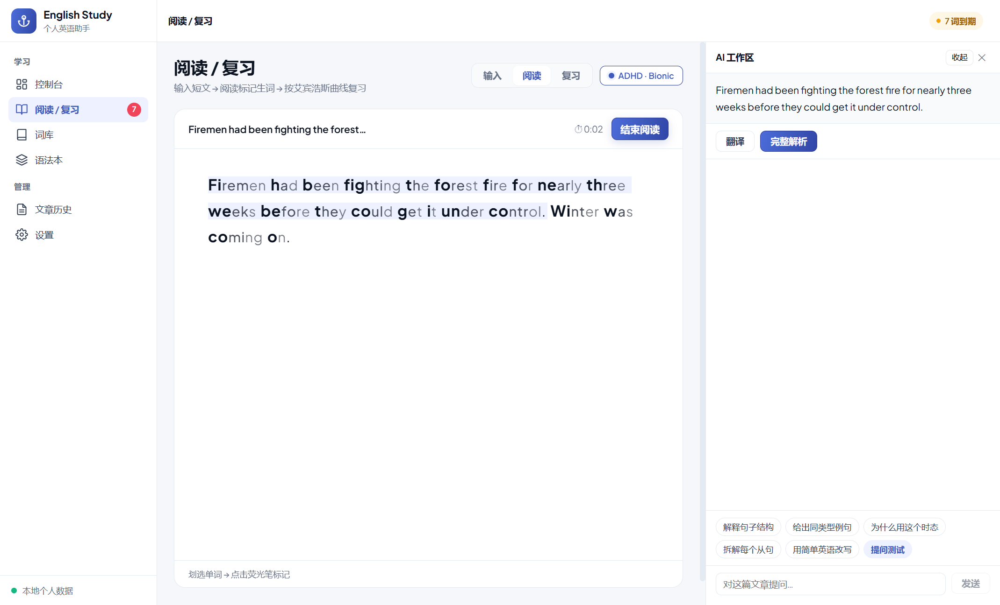
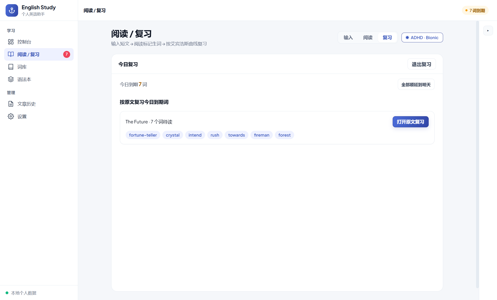
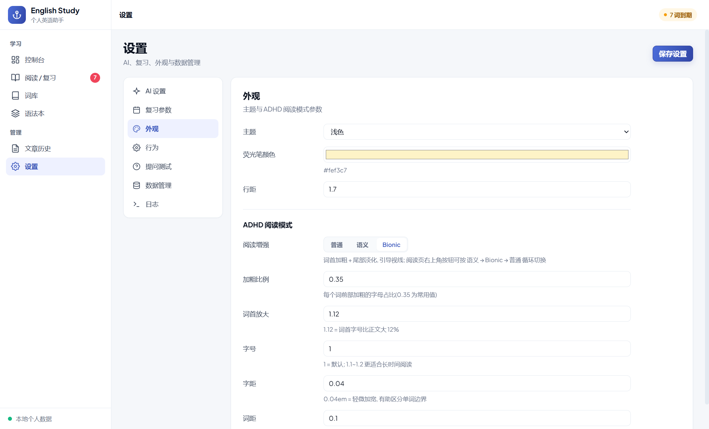

# English Study · 个人英语精读助手

一个 Windows 桌面端的个人英语学习工具：把「读文章 → 划生词 → 句子解析 → 间隔复习 → AI 提问」串成一条本地工作流。
Electron + Vue 3 + SQLite，所有学习数据保存在本机；AI 通过任意 OpenAI 兼容接口接入。

> 个人项目，按自己的学习习惯打磨，不追求通用产品形态。

<!-- 发布到 GitHub 后，把 <YOUR_GITHUB_USERNAME> 替换为你的用户名，即可启用徽章：
[](https://github.com/<YOUR_GITHUB_USERNAME>/english-study)
-->

## 截图

| 阅读与 AI 工作区 | 控制台 |
|---|---|
|  |  |

| 间隔复习 | 设置 |
|---|---|
|  |  |

## 功能

- **阅读 / 复习**：粘贴短文进入阅读模式；划选单词即写入生词本，标记/取消标记会同步回滚；结束会话自动记录阅读时长。
- **ADHD 阅读辅助**：语义增强 / Bionic 仿生 / 普通 三态，右上角一键循环；可调关键词密度、加粗比例、词首放大、字号、字距词距。
- **句子 AI 工作区**：单击句子即可翻译、完整解析（成分着色 + 语法树 + 被动/时态标记）、追问或生成提问测试；不选句时自动进入全文模式，按「标题 + 全文」提问。
  - 提问历史按**整篇文章一个会话**累积：同篇文章内切句/切页不丢，重启后仍在。
  - 结果分块缓存，重复查看秒开；任务显式按钮触发，选中句子本身不会调用 AI。
- **提问测试**：AI 基于当前句语法生成四选一题组，鼠标作答，即时/交卷判分；术语可点气泡查看解释并跳转语法本。
- **语法本**：完整解析过的句子自动按 7 组 44 个语法叶子归档，支持覆盖概览、搜索、批量删除、跳回原文；每个分类带可编辑的知识卡片。
- **艾宾浩斯复习**：生词/熟词两套间隔表，连续认识升熟词；到期词按来源文章分组复习，无来源词进入 AI 故事复习；熟词逐词确认卡片。
- **词库 / 文章历史 / 统计**：生词本与熟词本、CSV/JSON 导出、阅读日历、遗忘风险曲线、学习趋势。
- **统一 AI 配置**：任意 OpenAI 兼容 `baseUrl + apiKey + model`；支持从 `/models` 获取模型列表、连接测试；不内置、不自动启动任何本地模型。
- **数据本地化**：SQLite 数据库与词典副本都在本机应用数据目录，无遥测、无云同步。

## 技术栈

- Electron 43 + Vue 3 + vue-router
- better-sqlite3（本地数据库 + ECDICT 词典）
- electron-vite / Vite 7
- 任意 OpenAI 兼容 HTTP API（`/chat/completions`、`/models`）

## 快速开始（Windows）

### 环境要求

- Windows 10 / 11
- Node.js **22.12+**（推荐 22 LTS；安装时保持「Add to PATH」勾选）
- 首次安装需联网；磁盘预留约 2GB（依赖 + 词典解压后）

### 一键安装

1. 安装 [Node.js](https://nodejs.org/) 22 LTS 或更新版本。
2. 双击项目根目录的 **`setup.bat`**。它会自动：
   - 安装 npm 依赖；
   - 下载 ECDICT 词典（约 207MB，解压后约 800MB）并放到 `data/stardict.db`；
   - 校验词典并构建应用。
3. 双击 **`start.bat`** 启动。

首次安装视网络情况需要几分钟；安装完成后以后直接双击 `start.bat` 即可。

### 手动安装（或脚本失败时）

```bat
npm ci
:: 下载 https://github.com/skywind3000/ECDICT/releases/download/1.0.28/ecdict-sqlite-28.zip
:: 解压出 stardict.db，放到 data\stardict.db
npm run build
npm start
```

也可以把词典放在任意位置，通过环境变量指定：

```bat
set ES_DICT_SOURCE=D:\path\to\stardict.db
```

### 首次配置 AI

打开「设置 → AI 设置」：

1. 填接口地址（默认 `https://api.deepseek.com`，也可填 `https://api.openai.com/v1` 或自建服务地址）；
2. 填 API Key；
3. 点「获取模型」选择模型，或手动填写模型名；点「测试连接」确认可用。

> 本地自建服务（如自己启动的 llama.cpp `llama-server`）同样按 OpenAI 兼容地址填写；应用不会替你启动它。

## 词典说明

项目不随仓库分发 ECDICT 词典（体积过大）。词典来自 [skywind3000/ECDICT](https://github.com/skywind3000/ECDICT)（MIT），
`setup.bat` 使用其官方 [SQLite 发布包](https://github.com/skywind3000/ECDICT/releases/tag/1.0.28)。
没有词典时应用仍可启动，但查词释义、词频难度等词典相关功能会降级。

## 数据与隐私

- 数据目录：`%APPDATA%\english-study\data\`
  - `english-study.db`：词库、文章、复习记录、句子解析、语法本、设置
  - `stardict.db`：ECDICT 词典副本
- API Key 只保存在本机 SQLite 设置中，不会上传；AI 请求只发送到你配置的接口地址。
- 应用不包含遥测、账号或云同步。备份/导出可在「设置 → 数据管理」完成。

## 目录结构

```
src/
  main/        Electron 主进程（SQLite、IPC、AI 调用、句子解析/复习/统计服务）
  preload/     contextBridge 安全桥接
  renderer/    Vue 3 界面（阅读、工作区、语法本、词库、控制台、设置）
tools/         setup.bat 使用的词典下载/校验脚本
setup.bat      一键安装：依赖 + 词典 + 构建
start.bat      启动已构建的应用
```

## 常见问题

**双击 setup.bat 一闪而过？**
在文件夹地址栏输入 `cmd` 回车，再执行 `setup.bat`，即可看到完整报错。

**词典下载很慢/失败？**
手动下载 [ecdict-sqlite-28.zip](https://github.com/skywind3000/ECDICT/releases/download/1.0.28/ecdict-sqlite-28.zip)，解压出 `stardict.db` 放到 `data\stardict.db`，再重新运行 `setup.bat`。

**提示 Node.js 版本过低？**
升级到 Node.js 22.12+（推荐 LTS），重新打开命令行后重试。

**启动被 Windows SmartScreen 拦截？**
这是未签名应用常见提示，选择「更多信息 → 仍要运行」即可；请只从你信任的来源获取本项目。

**AI 报 401 / 403 / 超时？**
检查「设置 → AI 设置」的接口地址、Key、模型名；用「测试连接」定位问题。不同服务商的 baseUrl 版本前缀可能不同，
应用会在未带版本号时自动补 `/v1`，已带 `/v1` 则不重复拼接。

**没有词典也能用吗？**
可以启动和记词/复习，但查词释义与词频相关功能不可用；建议先跑 `setup.bat`。

## 开发

```bat
npm install
npm run dev      :: 开发模式（HMR）
npm run build    :: 构建到 out/
npm start        :: 启动构建产物
```

## 许可证与致谢

- 代码：MIT，见 [LICENSE](LICENSE)（发布前请替换 `<YEAR>` / `<COPYRIGHT HOLDER>` 占位符）。
- 字体：Plus Jakarta Sans（SIL OFL 1.1）；词典：ECDICT（MIT）；详见 [THIRD_PARTY_NOTICES.md](THIRD_PARTY_NOTICES.md)。
- 仿生阅读/语义高亮为独立实现，参考公开的阅读辅助思路，不隶属于任何第三方阅读插件。

## 发布前需要替换的占位符

| 位置 | 占位符 | 说明 |
|---|---|---|
| `LICENSE` | `<YEAR>` / `<COPYRIGHT HOLDER>` | 年份与版权人 |
| `package.json` | `<YOUR NAME>` | 作者名 |
| `README.md` | `<YOUR_GITHUB_USERNAME>` | GitHub 用户名（徽章/链接） |
